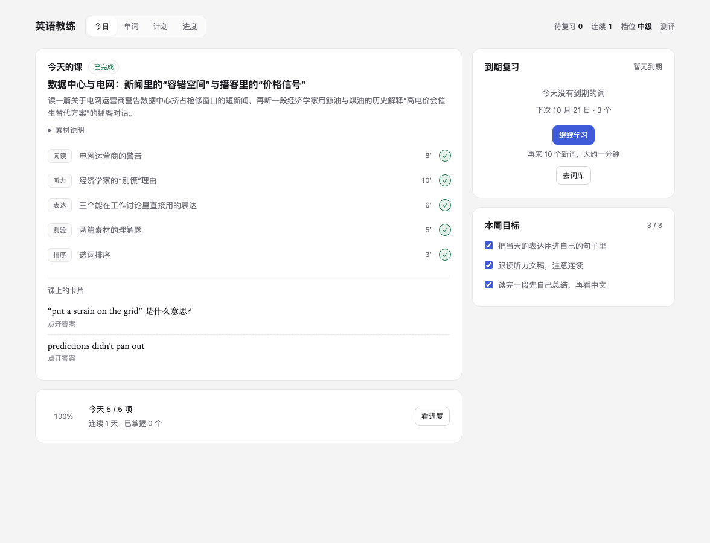
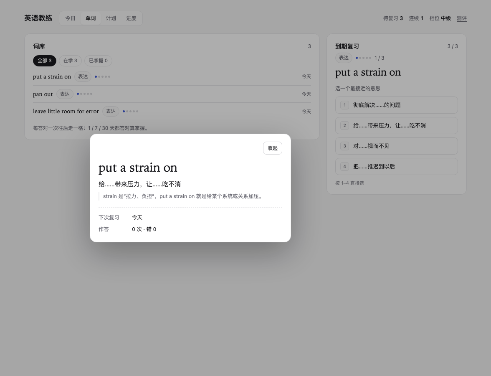

# 英语教练 · English Coach

[](LICENSE)

> **English Coach** is a plugin for DeepSeek Harness (desktop) that prepares one English lesson a day, keeps a spaced-repetition queue, and gets out of your way. Materials are sourced from public pages, matched to your level, and saved as drafts until you start them. The interface is Chinese; English appears only in the learning material. No API key, local-first, MIT.

**英语教练**是装在 DeepSeek Harness 里的英语学习插件。界面是中文，英文只出现在学习材料里。它替你做每天那件二三十分钟的杂活——判断水平、找难度合适的材料、抠出值得记的表达、排复习——你只负责学。

- **每天一课，自动备好**：Agent 按你的画像和近期工作方向找公开素材，加工成阅读、听力、表达、测验（可选排序），先存成草稿；你点开始才算开始。
- **水平与路线**：词汇／语法短题自适应测评可选完整 20 题或简短 10 题，给出六个中文档位之一、能力参照和薄弱方向，仅供安排学习；学习路线按当前有效档位建立，未测评也能先学。
- **复习有排期**：单词和整块表达从零格初学到四格掌握，答对后按 1 / 7 / 30 / 90 天排期；答错不退格，留在本批直到纠正正确。批次、反馈与首次答对／重试成绩可在刷新、重开及跨日后恢复。
- **碎片时间**：右下角一颗可拖动的药丸，显示待复习数，点开是下一个词，一键回到面板复习。
- **进步看得见**：已掌握数量、连续天数（允许跳一天不断签）、水平曲线、薄弱项。
- **词库与学习批次**：四级、六级（含四级基础）、雅思开源参考词库可搜索和分页。旧词优先，当前库新词优先；继续学习直接使用静态基础练习，显式按画像补词才用模型。每批默认10、范围3–30，不是每日上限。
- **手动朗读**：阅读、听力、单词和表达支持朗读；文章暂停继续、文本跳播、静默书签恢复及四档语速。Kokoro 在明确准备资源后由 DSH 主机本地生成；也可手动选择当前网页设备上允许的本地英语系统音色。

已在 macOS 桌面 DSH `0.2.1-rc.5` 安装并确认 Heart 本地音色的实际试听正常；长文恢复、全部音色与窄面板矩阵仍待进一步验收。以下截图为早期界面。词库去重7,638词面，其中261项可练（约3.4%），其余保留原因，不冒称逐词专业审校。



主面板是一张工作台：左边是当天要做的，右边常驻复习卡。

| 单词视图：词库 + 复习 | 词条详情 |
|:--:|:--:|
|  |  |

## 环境要求

- **当前源码：DeepSeek Harness 桌面版 `0.2.2-rc.2`**：`engines.dsh` 精确声明此版本，开发验证使用兼容 Node `24.21.0`。沿用宿主级调度和分页会话事件接口，并为可拖动药丸及弹出卡片显式声明 macOS 窗口交互区域。自动回归不等于真实 GUI 操作或语音试听验收，不推断其他版本兼容。
- **一个可用的模型连接**：首次出题、生成课程都要让模型跑一轮。
- **不需要 API key**，不需要在本机装 Node、pnpm 或任何依赖。
- 生成课程时需要联网：素材由 Agent 搜索并抓取公开网页。

## 安装

### 从 npm 安装（推荐）

公开包为 [dsh-english-coach](<https://www.npmjs.com/package/dsh-english-coach>)，当前正式版本 **`0.1.3`**，适配 DSH `0.2.2-rc.1`。公开 npm 的 `latest` 已指向该版本。

1. 在 DSH `0.2.2-rc.1` 打开「插件」→「添加插件」→「安装第三方插件」。
2. 在「包名或地址」填写 `dsh-english-coach`；固定本版本可填写 `dsh-english-coach@0.1.3`。若镜像尚未同步，选择「npm 官方源」。
3. 确认安装后按提示启用。侧边栏出现「英语教练」即可使用，不需要克隆仓库、开发者本地目录或 npm 登录。

> `@lijingtong/dsh-english-coach` 是原本地源码包身份，不是本次公开 npm 包名。两者共用插件入口与学习数据位置，**不要同时启用**；更换来源前先备份学习数据，移除旧包后再安装公开包。公开包保留独立的第三方对应源与通知材料，以实际安装包的 `NOTICE.md` 和 `speech/source/` 为准。

**说明范围：** 本文的简短测评、统一定档与首次具体目标对应当前源码，尚未随新的 npm 版本发布；源码仍保留 `0.1.3` 版本号，不代表这些改动已经进入公开的 `dsh-english-coach@0.1.3`。安装已发布包不会自动获得尚未发布的源码功能。

### 从源码安装

在 DSH `0.2.2-rc.2` 使用包含本次适配的源码，找到 `english-coach/` 目录，在「插件」→「添加插件」→「安装第三方插件」的「包名或地址」输入框填写该目录的绝对路径，不是仓库根目录。插件管理器的 `install_bundle` 同样接受准确 npm 包名或该绝对目录。本地未提交的适配不会自动出现在远端克隆中。

### 更新

先备份学习数据。DSH `0.2.2-rc.1` 支持在插件页更新符合条件的 npm 插件，`0.1.3` 已可从 npm 官方源获取。也可按插件管理器提示移除旧来源，再从更新后的插件目录安装；若已使用源码链接，应按宿主提示重新加载或重启并刷新页面，不把磁盘修改视为已加载。只更新仓库或刷新页面不会替换已安装的 npm 包。不要添加版本豁免跳过宿主检查；当前源码声明 `0.2.2-rc.2`，公开 npm `0.1.3` 仍声明 `0.2.2-rc.1`，不能直接用于新版宿主。移除插件不会删除学习数据，本次更换包名或来源也不迁移数据。

## 第一次用

1. 侧边栏点「英语教练」，填写用途、每天时长、目标档位和兴趣；可保留或修改工作上下文，也可在「为什么学英语」里填写多行具体目标。具体目标可留空，之后仍能编辑。
2. 可以直接点「生成今天」或「继续学习」。没有有效测评时从入门材料起步，状态仍是「未测评」；目标档位不代替当前水平，也不自动切换静态词库。
3. 想测评时，主动点「生成测评题库」。Agent 需准备至少 24 道独立词汇／语法短题，六个难度各至少 4 道，不含文章或音频；就绪后再主动选择完整 20 题或简短 10 题，不会自动开测。
4. 点选即提交，也可点「不会，继续」；点「稍后继续」可暂停，重开恢复同场进度。只有收满约定的 10／20 条响应才有正式结果，完成后显示档位、正确／错误／不会数量、答对率和薄弱方向。结果是「根据词汇与语法短题估计，仅供安排学习」，测评不提供即时答案或逐题回顾。

之后每天在「今日」点「生成今天」，或在设置里开启每日自动化让 Agent 到点备好草稿。首次取得有效结果或之后档位变化会重建大纲，同档复测与刷新不重建；也可主动重新生成。重建后本周目标勾选重新开始，实际已学天数、已有课程、词汇进度和复习排期保留。

旧测评按保留的原作答事实统一重算；最新完成记录无法重算时按未测评处理，不回退更早成绩，旧路线重建一次。升级前请备份数据，详情见[已有测评记录](<english-coach/README.md#已有测评记录>)。

## 每天怎么用

| 时机 | 做什么 |
|---|---|
| 早上（若开启自动化） | 到点自动生成草稿，药丸提示「今日课程已就绪」 |
| 有空时 | 主面板「今日」→ 开始这一课 → 逐项完成；右栏随时把到期的词刷掉 |
| 碎片时间 | 点右下角药丸 → 「在面板里复习」，按 `1`–`4` 选、回车进下一张 |
| 想多学几个 | 点「继续学习」取下一批；当前词库静态补齐缺额，不等待模型。没有合格候选时可主动选库或按画像补词 |
| 每周 | 「计划」看本周目标完成度；「进度」看水平曲线 |

## 数据与隐私

- **数据只在本机**。默认在 `~/DeepSeek-English/`，是普通的 JSON 和 Markdown，可以直接备份、拷走、用编辑器打开；设置页可以把目录改到别处（会先复制再切换）。
- **插件不收集遥测**，不上报学习数据，不内置任何统计或追踪。
- **生成走你自己的模型连接**。出题、生成课程时，Agent 会把提示词和素材交给你在 Harness 里配置的模型服务，并用平台的搜索/抓取能力取素材。Kokoro 资源只在明确准备或修复时从固定来源下载；本地合成不请求第三方语音服务。
- **课程文本保存在本机**。为面板阅读和朗读，课程保存采用的正文/听力文稿及原始链接、抓取时间和许可说明，不下载整个来源站点。
- **语音来源和处理位置**。Kokoro 文本在 DSH 主机处理；远程网页需要把文本交给主机，不表示文本始终留在浏览器设备。系统语音仅使用网页设备上明确标为本地的英语 Shelley / Reed / Sandy 家族；缺声不自动换声。书签只保存正文指纹和句段位置。
- **插件专属存储**：`~/.dsh/english-coach/root.json` 记住数据目录；明确准备的 Kokoro 资源单独放在 `~/.dsh/english-coach/speech/`（设置 `DSH_HOME` 时随之定位）。开启每日自动化时，会话与调度由 Harness 宿主创建和保存。
- **删干净**：移除插件不会动数据；想彻底清空，先备份再删 `~/DeepSeek-English/`。

完整的数据布局、工具接口和设计取舍见 [english-coach/README.md](english-coach/README.md)。

## 已知限制

- 口语与发音不做评分。
- Kokoro 模型及四声音色需明确准备，不随普通包捆绑；系统音色取决于网页设备，真人素材原录音接口尚未实现。真实宿主长文听感和媒体恢复仍需验收。
- 不声称与任何外部考试分数等价。
- 每次生成课程、生成题库都要模型跑一整轮，有用量成本；自动化默认关闭，生成物先落草稿。
- 一次安装 = 一个学习者；不做多账号、社交、排行榜、跨设备同步。
- 只在 macOS 桌面版上实测过；Windows / Linux 尚未验证。
- 素材能不能抓到取决于网络与搜索源，抓不到时会换源，不会编造。

## 开发

```bash
cd english-coach
node scripts/dev.mjs npm ci --ignore-scripts
npm run check:environment -- --json
npm test
npm run check:package
npm run source:search -- "speech.assets.status"
```

[开发工具入口](<english-coach/scripts/dev.mjs>)统一选择已有兼容 Node、监督隔离测试并保留真实退出码；本地测试依赖由锁文件固定，不依赖其它 checkout。只读预检核对实际宿主公开版本准入和安装源，源码搜索默认排除 vendor 与实验树，参数及结果说明见[插件开发说明](<english-coach/README.md#开发>)。插件由 [Host](<english-coach/index.js>)、[Client](<english-coach/client.js>) 和领域模块组成；完整测试包含 execute 隔离状态、Host 通信及真实 React DOM 交互。真实包检查会解包并对产物再次执行测试、核对临时目录、报告跳过项；未显式提供八件实际资源夹具时相关测试会跳过，不等于真实宿主试听。

```
english-coach/
├── index.js        Host 半：六个 Agent 工具、Remote 路由、每日调度
├── client.js       Client 半：今日 / 单词 / 计划 / 进度、药丸、设置
├── core/           领域层：测评、复习、课程、锚题、存储
├── test/           领域、Host 通信及 React DOM 交互测试
├── data/           固定版本参考词库、练习、校验和与 MIT 通知
├── docs/           截图与 ADR
├── locale/         界面文案
├── SPEC.md         要做什么，以及怎么判定做对了
├── DESIGN.md       为什么这样设计
├── GLOSSARY.md     术语表
└── NOTICE.md       来源与授权说明
```

## 文档

| 文件 | 内容 |
|---|---|
| [使用说明](<english-coach/README.md>) | 当前功能、运行要求、数据及限制 |
| [SPEC.md](english-coach/SPEC.md) | 初版历史需求、用户故事与测试决策，不代表当前全部功能 |
| [DESIGN.md](english-coach/DESIGN.md) | 架构、数据模型、状态机与取舍理由 |
| [GLOSSARY.md](english-coach/GLOSSARY.md) | 领域术语 |
| [docs/adr/](english-coach/docs/adr/) | 架构决策记录 |
| [NOTICE.md](english-coach/NOTICE.md) | 锚题、素材、词表与图标的来源说明 |

## 参与

Issue 和 PR 都欢迎。改 `core/` 之前请先跑上面的测试；改界面请在真实插件里看一眼，而不只是看代码。

## 许可

[MIT](LICENSE)。锚题、图标与素材的处理方式见 [NOTICE.md](english-coach/NOTICE.md)。

英语教练与 DeepSeek 官方没有隶属关系，是第三方插件。
