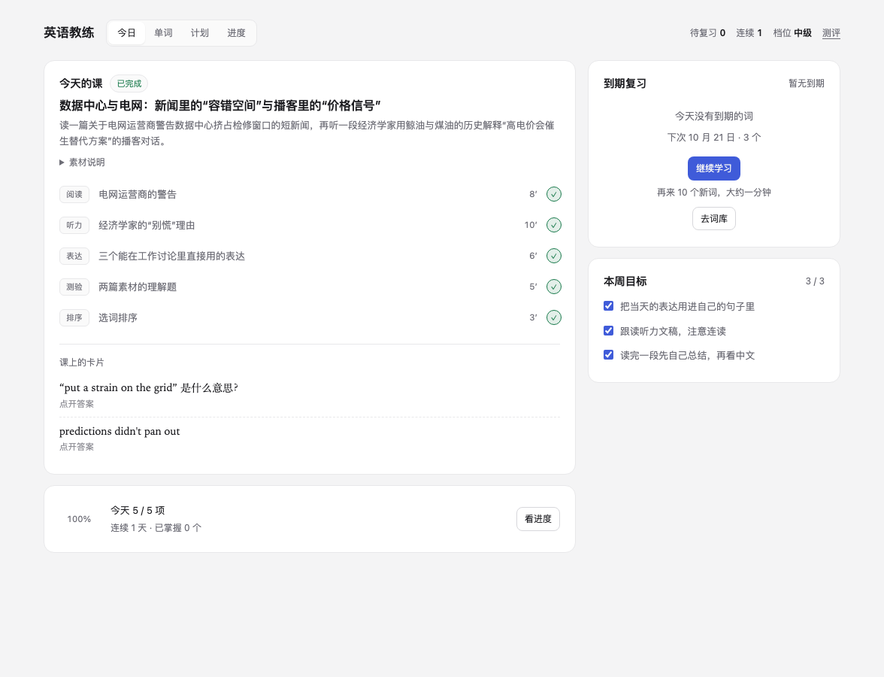
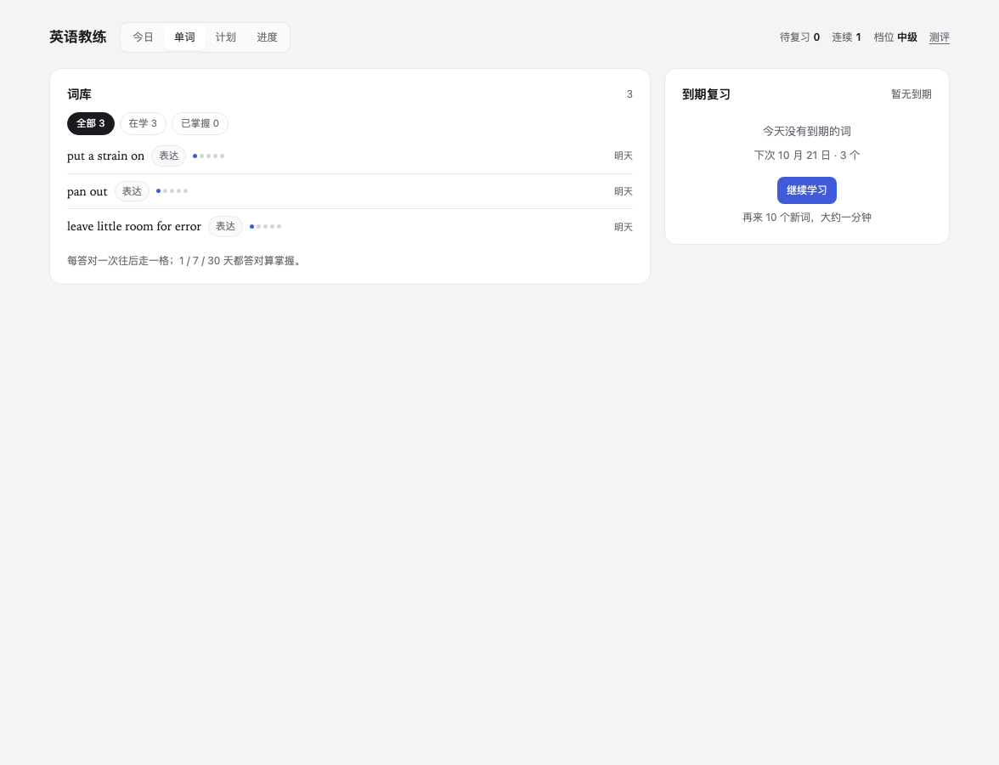
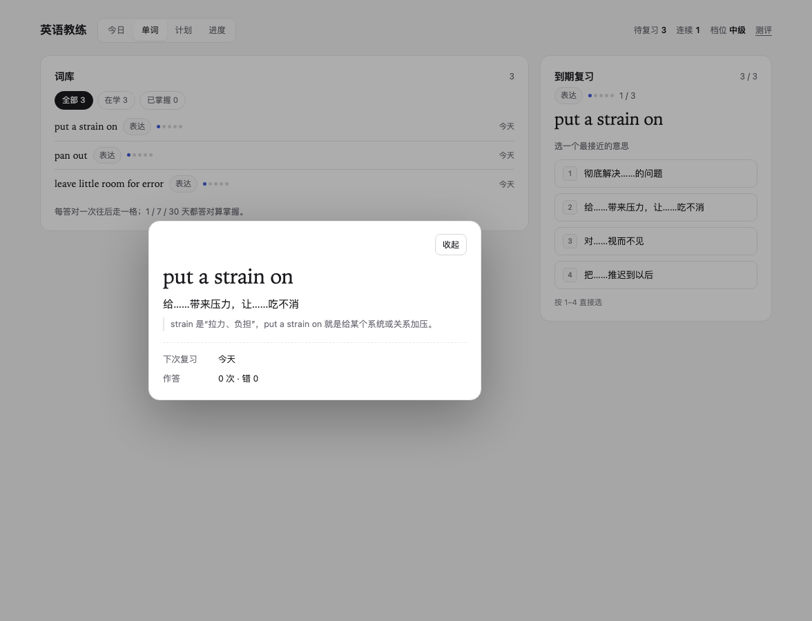
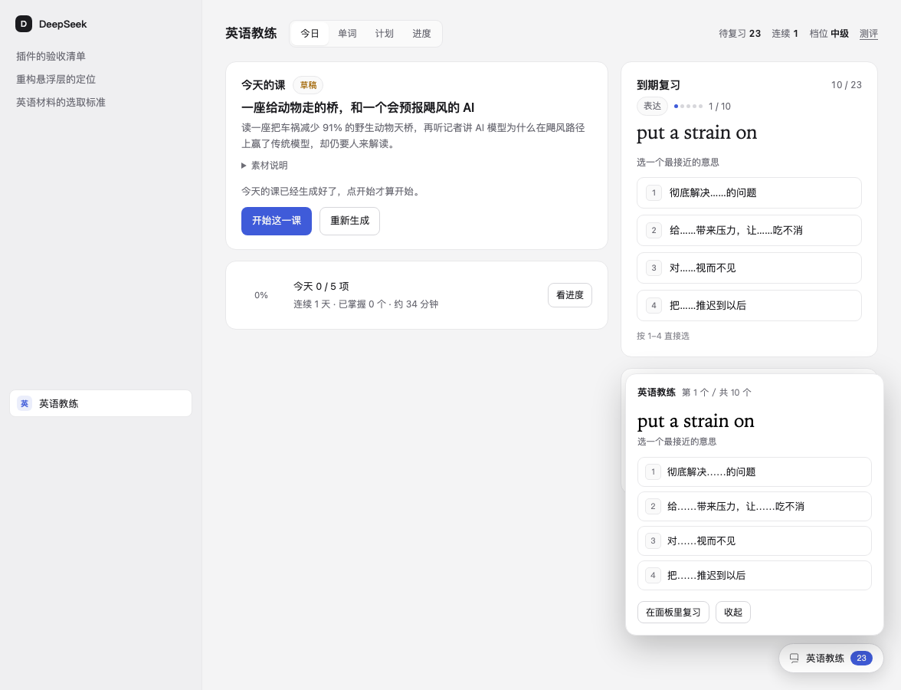

# 英语教练 · English Coach

> A DeepSeek Harness plugin that prepares one English lesson a day, keeps a spaced-repetition queue, and stays out of the way. Chinese UI; English only in the learning material. No API key, local-first, MIT.

**英语教练**是装在 DeepSeek Harness 里的英语学习插件。它替你做那件每天要花二三十分钟的杂活：判断水平、找难度合适的材料、抠出值得记的表达、排复习。你只负责学。

[](LICENSE)

## 它是什么

- **今天学什么** — 每天由 Agent 按你的画像和近期工作方向找素材、加工成一课，先存草稿，你点开始才算开始。
- **词** — 所有来源的到期旧词优先，其次是已加入但未首次作答的新词；当前词库的新词优先。本轮题目保持稳定，切库下一批生效。`1`–`4` 直接选，答完给释义和讲解。
- **碎片时间** — 右下角一颗药丸，显示待复习数，点开就能答：词、四个释义、点一个，答完给讲解；按住可以拖到别处，位置记在本机。
- **想多学** — 统一点「继续学习」：先取到期旧词和已加入新词；已选词库时使用该库的内置基础练习，未选词库且没有可学候选时按画像由 Agent 准备新词。每批默认 10，可调 3–30，不是每日上限。
- **听英文** — 阅读、听力、单词和表达支持手动朗读；文章可暂停、继续、重听和拖动文本进度，跨重开静默恢复书签。
- **有没有进步** — 已掌握数量、连续天数、水平曲线、薄弱项。

「今日」把课程放在左边，单词学习放在右栏；「单词」以本轮学习为主，查词与设置按需打开。



「单词」先显示本轮练习，词表从下方「我的词汇 / 主题词库」按需展开。支持完整集合的中英文搜索、状态筛选和 50/20 条分页；查词、查看详情或收起词表不会打断当前题目。学习安排可更换新词来源、调整每批数量，均从下一批生效；浏览、翻页和选库都不会整库入队。以下截图为早期界面，当前控件以实际版本为准。



点词库里的词，能看到释义、讲解、下次复习和作答记录。



药丸在别的会话里也是复习台：点开就是一张卡，答完当场给释义和讲解，接着下一个。



## 环境要求

- DeepSeek Harness **桌面版 `0.2.1-rc.2`**：当前 `engines.dsh` 仅声明这个精确版本，不推断其他版本兼容。插件依赖宿主的插件槽位、持久化调度与本地文件写入。
- Node.js：`engines.node` 为 `>=24.21.0 <25`，以该桌面版内置的 Node `24.21.0` 为验证基线；桌面用户无需自行安装 Node。
- 一个可用的模型连接：首次出题、生成课程都要让模型跑一轮。
- 不需要 API key，也不需要在本机装 Node 或任何依赖。
- 生成课程时需要联网：素材由 Agent 搜索并抓取公开网页。

## 安装

在插件管理里安装本目录（`plugin_manager` 的 `install_bundle`，目标为这个文件夹的绝对路径），或在插件页的「本地安装」里选它。装完不需要填任何 API key。

更新：`git pull` 后在插件页重新加载插件。

## 第一次用

1. 侧边栏点「英语教练」，填三件事：想用英语做什么、每天能挤出多久、目标档位。
2. 点「生成测评题库」，等一分钟让 Agent 出一套题；再点「开始测评（20 题）」。
3. 做完看到六个中文档位之一、一句参照、以及薄弱环节。大纲会自动生成。

## 每天怎么用

| 时机 | 做什么 |
|---|---|
| 早上（若开启自动化） | 到点自动生成草稿，药丸提示「今日课程已就绪」 |
| 有空时 | 主面板「今日」→ 开始这一课 → 逐项完成（阅读、听力、表达、测验、排序）；右栏「单词学习」兼顾到期复习和新词学习 |
| 碎片时间 | 点右下角药丸，直接答一张卡：点一个释义，答完看讲解，然后「下一个」；药丸可以拖到顺手的位置，也可点「打开主页」回到今日页 |
| 想多学几个 | 点「继续学习」，先使用到期旧词与已加入新词，再按当前词库补足本批；无合格候选时会说明原因，不暗中换源 |
| 想看看有什么词 | 「单词」→ 我的词汇 / 主题词库，搜索、筛选、翻页和查看详情 |
| 每周 | 「计划」看本周目标完成度；「个人」看进度和曲线，填写目标与兴趣 |

## 设置

设置从独立分区进入，不占主面板视图：

主面板「个人」页先显示已保存目标，就近对照当前水平估计与目标档位；长目标和全部兴趣可只读展开，不必进入编辑。点击「编辑个人目标」再修改，保存成功收起，取消放弃草稿；失败和后台轮询不覆盖草稿，离开插件内视图会提示未保存修改。下方默认显示三项学习概况，点击「查看记录」可看带日期和档位的水平曲线、完整测评记录、在学数量与诊断。

设置页保留：
- 每批学习 / 每次补充词数（3–30，默认 10）：也供课程建议出词量使用；保留旧合法设置，同日可以继续多批
- 每日自动生成：开关与生成时间（**默认关闭**）
- 音频来源：系统语音合成（默认）/ 素材自带音频（尚未实现）
- 数据目录：查看或迁移

## 主题词库与朗读

内置 ECDICT 固定版本的开源学习参考子集，不是官方考试全集或分数保证：

| 词库 | 目录词数 | 可练基础题 |
|---|---:|---:|
| 四级 | 3,849 | 119 |
| 六级（含四级基础） | 5,805 | 178 |
| 雅思 | 5,040 | 143 |

跨库去重后共 7,638 个词面，其中 261 个有可练基础题（约 3.4%）。当前采用保守门槛，多义、污染及已发现语义风险条目只供浏览并说明原因；目录总量不等于可练数量。自动结构检查与非专业抽查不等于逐词专业审校。详细来源、版本、校验和与加工规则见 [数据清单](<data/manifest.json>) 和 [数据通知](<data/NOTICE.md>)。

同一规范词面跨课程、补词和词库共享既有进度，不覆盖原释义、盒子或排期；不自动合并词形、英美拼写或历史重复记录。当前词库只影响后续批次与新课程建议，选库不重做旧课。

点击单词、表达或例句旁的喇叭图标即可发音；悬浮卡、学习卡与词库共用这套入口。音色与倍速统一在「今日」右栏「单词学习」下方的「朗读设置」卡片调整，阅读、听力和词条内不再重复放设置或展开入口。支持试听、记忆选择和 0.5 / 1.0 / 1.5 / 2.0 四档语速。

朗读使用宿主实际可用的英语音色。联网音色可能把朗读文本发送给语音服务；本地/联网属性以宿主报告为准。文章进度以句段定位，不是精确秒数；恢复失败或重开时可能少量重读当前句。单词插播会暂停文章，结束后不会自动续文。此版本的真实目标宿主音质、恢复稳定性和窄面板布局尚需验收，自动测试不证明这些体验。

## 数据在哪

默认 `~/DeepSeek-English/`，全部是普通 JSON 与 Markdown，可以直接备份、拷走、用编辑器看。设置页可以改到别的目录（会先复制再切换）。

```
~/DeepSeek-English/
├── profile.json          画像
├── settings.json         自动化、音频来源、界面
├── level.json            历次水平估计（曲线）
├── syllabus.json         大纲与本阶段目标
├── progress.json         完成日期、过期草稿数
├── review/items.json     复习项与盒子状态
├── review/log.jsonl      每次复习作答
├── audio/bookmarks.json  文章身份、正文版本与文本位置
├── anchors/items.json    锚题池（冻结，含哈希）
├── anchors/responses.jsonl
├── assessments/          题库与每次测评
├── lessons/YYYY-MM-DD.json / .md
├── sources/provenance.jsonl  每份素材的出处、抓取时间、许可
└── jobs.json             生成任务与每日调度绑定
```

写入都是「先写临时文件，再 rename」，并在切换前保留上一版 `.bak`。文件被截断时读取会回退到备份并给出警告，不会崩。

## 给 Agent 的六个工具

| 工具 | 方向 | 作用 |
|---|---|---|
| `english_state` | 读 | 画像、大纲、最近档位、到期复习数、近 7 天用过的素材、今天有没有课 |
| `english_save_lesson` | 写 | 提交一课；以日期为幂等键，重复提交覆盖不追加 |
| `english_save_assessment` | 写 | 提交一套至少 20 题、难度 1–6 的四选一题库 |
| `english_add_words` | 写 | 补充词汇：加入复习队列、当天可学；与已有词重复的会被跳过 |
| `english_record` | 写 | 批量补记作答与完成状态，按项去重 |
| `english_vocabulary` | 读 / 写 | 浏览词库、保存偏好、显式补词；生成课程前获取实时词库上下文 |

所有工具都返回同一形状：`{ ok: true, data, warnings }` 或 `{ ok: false, code, message, field? }`。校验失败不会抛异常，Agent 能读到原因并据此修正。

## 几个刻意的取舍

- **不编造素材**。每份阅读与听力必须带可访问链接、抓取时间、许可说明，缺一项就拒绝落盘。抓不到就换源，并把换了什么写进课程备注。
- **界面上不出现任何国际分级框架的名称**。六个中文档位是自建的显示层；参照只说「大致相当于」。
- **锚题自制、冻结、只退役不修改**。它只是粗检，连续三次偏离只在曲线旁加一句话，不改分数。
- **掌握的定义是硬的**：在 1 天、7 天、30 天三个间隔各答对一次。答错就回到第一盒，掌握不成立。
- **自动化默认关闭**。开启后才建每日调度；关掉应用期间漏掉的天数只补最近一次。
- **词库不拥有个人进度**。目录、当前来源偏好和复习项分开建模；浏览分页不截断学习队列。用尽不会自动调用模型或更换词库。

## 隐私

- 插件不收集遥测，不上报学习数据。
- 学习数据只写在本机数据目录；插件自己只额外写一个指针文件 `~/.dsh/english-coach/root.json`（记住数据目录位置），开启自动化时的会话与调度由 Harness 宿主管理。
- 生成课程、测评及按画像补词时，提示词和素材会交给 Harness 配置的模型服务，搜索与抓取走平台能力。静态词库补词不现场调用模型或下载词典；联网朗读仍可能外发英文文本。
- 课程保存采纳的阅读正文、听力文稿及来源链接、抓取时间、许可说明；不会缓存完整来源网站。
- 想删干净：移除插件不会动数据，手动删掉数据目录即可（先备份）。

## 已知限制

- 口语与发音不做评分。
- 不做图片/视频生成；听力声音来自浏览器自带的语音合成，音色随系统。
- 不声称与任何外部考试分数等价。
- 首次测评与每日生成都需要模型跑一轮，会产生用量；自动化默认关闭就是为了这个。
- 一次安装 = 一个学习者；不做多账号、社交、排行榜、跨设备同步。
- 只在 macOS 上实测；Windows / Linux 未验证。
- 素材可达性随网络环境变化，抓不到时会换源，不会编造。

## 常见问题

**需要 API key 吗？**
不需要。题目和课程都用 Harness 里已经配好的模型生成。

**会消耗多少额度？**
生成一套测评题库、生成一课各要跑一整轮模型（含搜索与工具调用）；做测评本身不额外调用模型。自动化默认关闭，课程先落草稿，不点开始就不会继续。

**断签一天会怎样？**
连续天数允许间隔一天，隔天再学仍然连着；超过才算断。进度统计只认完成态。

**换电脑怎么办？**
把数据目录整个拷过去，在新机器的设置里把数据目录指到同一个位置。

**能两个人共用吗？**
不能。一次安装对应一个学习者。

**抓不到素材怎么办？**
Agent 会换源并把换了什么写进课程备注；连续失败可以在面板点「重新生成」。

**界面能切成英文吗？**
不能，这是刻意的：界面固定中文，英文只出现在材料里。

## 卸载

插件管理里移除本 bundle 即可。数据目录不会被动，留着下次还能用；想清干净就手动删掉 `~/DeepSeek-English/`。

## 开发

```bash
npm run test:core
npm run test:ui
npm test
npm run check:package
```

UI 测试需要开发环境已提供 React 18.3 / React DOM 18.3 / jsdom 29，可通过 `NODE_PATH` 指向已有环境；插件本身不分发这些开发依赖。使用声明兼容的 Node 24.21.x。缺少 UI 测试环境会明确失败，不静默跳过。

`check:package` 需要开发机提供 npm 和 tar；它使用 `npm pack --ignore-scripts --offline` 生成真实压缩包，检查发布文件、许可证、入口及模块导入，并针对解包后的代码运行全部领域、Host Adapter 与 React DOM 测试，核对词库校验和与必要许可。产物和日志保存在仓库忽略的 `.scratch/package-check/`，不安装插件、不激活 Host、不访问真实学习数据。也可直接运行 `node scripts/check-package.mjs`。

兼容性声明以本机已知环境为边界：2026-10-21 核对桌面版运行清单及内置 DSH 均为 `0.2.1-rc.2`，内置 Node 为 `24.21.0`；历史功能验收见设计文档。本轮打包检查不代表修复包已通过一次性 Profile 的安装、冷启动、卸载、回滚，亦不代表通过商城审核。其他 DSH 版本及跨平台矩阵尚未验证。

领域与状态全部在 `core/`，是一层纯 Node 模块：给定数据目录与一条命令，返回结果并落盘。Host 做平台接线（工具、路由、调度），Client 做界面和共享语音。领域测试通过公开 execute 命令；UI 测试挂载真实 React DOM，仅在语音、宿主通信等外部依赖使用可控 Adapter。真实声音与宿主行为需单独验收。

设计文档在本目录：[SPEC.md](SPEC.md)、[DESIGN.md](DESIGN.md)、[GLOSSARY.md](GLOSSARY.md)、[docs/adr/](docs/adr/)。来源与授权说明见 [NOTICE.md](NOTICE.md)。

## 许可

MIT，见随插件分发的 [LICENSE](LICENSE)（与仓库根目录的许可证一致）。锚题、素材、词表与图标的来源见 [NOTICE.md](NOTICE.md)。

英语教练与 DeepSeek 官方没有隶属关系，是第三方插件。
