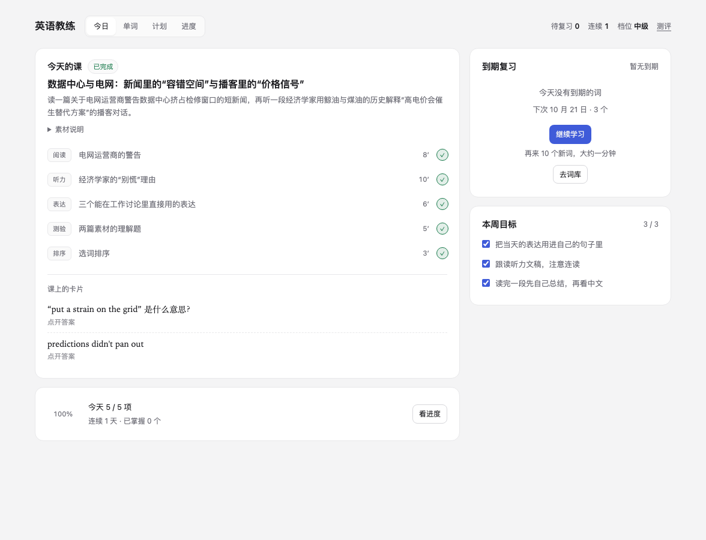
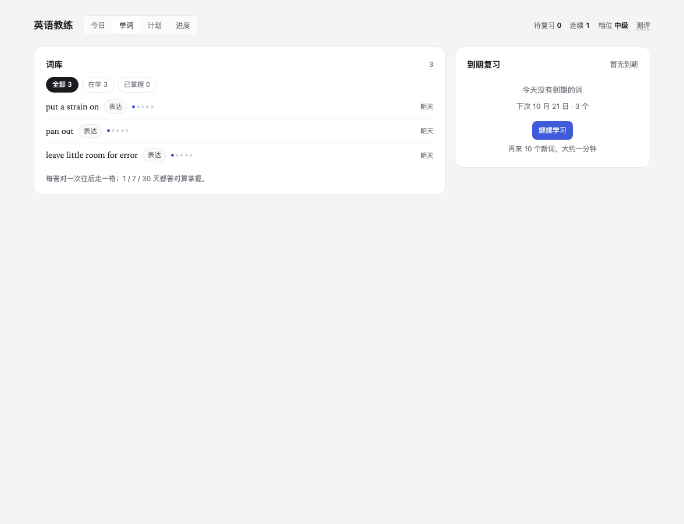
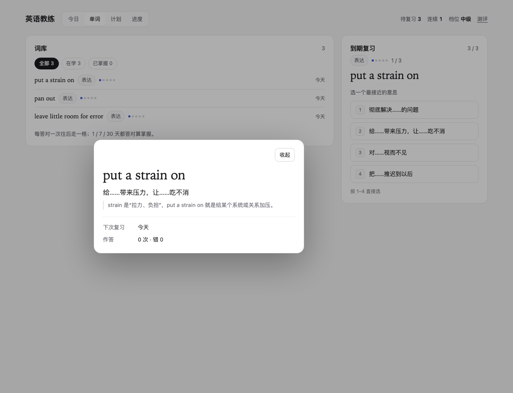
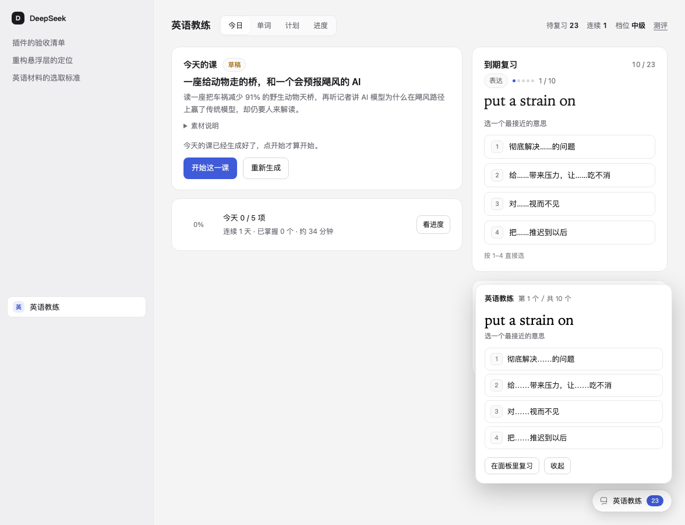

# 英语教练 · English Coach

> A DeepSeek Harness plugin that prepares one English lesson a day, keeps a spaced-repetition queue, and stays out of the way. Chinese UI; English only in the learning material. No API key, local-first, MIT.

**英语教练**是装在 DeepSeek Harness 里的英语学习插件。它替你做那件每天要花二三十分钟的杂活：判断水平、找难度合适的材料、抠出值得记的表达、排复习。你只负责学。

[](LICENSE)

## 它是什么

- **今天学什么** — 每天由 Agent 按你的画像和近期工作方向找素材、加工成一课，先存草稿，你点开始才算开始。
- **词** — 所有来源的到期旧词优先，其次是已加入但尚未完成初学的新词；当前词库的新词优先。今日、单词页和悬浮层共用已保存批次、当前题、反馈与成绩，刷新重开仍续原批；切库下一批生效。`1`–`4` 直接选，错词回本批队尾，直到答对才算完成，不扣进度。
- **碎片时间** — 右下角一颗药丸，显示待复习数，点开就能答：词、四个释义、点一个，答完给讲解；按住可以拖到别处，位置记在本机。
- **想多学** — 统一点「继续学习」：先取到期旧词和已加入新词；已选词库时使用该库的内置基础练习，未选词库且没有可学候选时按画像由 Agent 准备新词。每批默认 10，可调 3–30，不是每日上限。
- **听英文** — 阅读、听力、单词和表达支持手动朗读；文章可暂停、继续、重听和拖动文本进度，跨重开静默恢复书签。阅读与听力的逐段中文译文默认收起，点击对应段落下的「译文」才展开。
- **有没有进步** — 已掌握数量、连续天数、水平曲线、薄弱项。

「今日」把课程放在左边，单词学习放在右栏；「单词」以本轮学习为主，查词与设置按需打开。



「单词」先显示本轮练习，词表从下方「我的词汇 / 主题词库」按需展开。支持完整集合的中英文搜索、状态筛选和 50/20 条分页；查词、查看详情或收起词表不会打断当前题目。学习安排可更换新词来源、调整每批数量，均从下一批生效；浏览、翻页和选库都不会整库入队。以下截图为早期界面，当前控件以实际版本为准。



点词库里的词，能看到释义、讲解、下次复习和作答记录。



药丸在别的会话里也是复习台：点开就是一张卡，答完当场给释义和讲解，接着下一个。



## 环境要求

- DeepSeek Harness **桌面版 `0.2.2-rc.1`**：本版 `engines.dsh` 仅声明这个精确版本，不推断其他版本兼容。已适配宿主级调度请求与分页会话事件读取；该宿主会在安装与加载时检查版本要求，不要用版本豁免代替更新插件。插件依赖宿主的插件槽位、持久化调度与本地文件写入。
- Node.js：`engines.node` 为 `>=24.21.0 <25`，以该桌面版内置的 Node `24.21.0` 为验证基线；桌面用户无需自行安装 Node。
- 一个可用的模型连接：首次出题、生成课程都要让模型跑一轮。
- 不需要 API key，也不需要在本机装 Node 或任何依赖。
- 生成课程时需要联网：素材由 Agent 搜索并抓取公开网页。

## 安装

公开包为 [dsh-english-coach](<https://www.npmjs.com/package/dsh-english-coach>)，本版 `0.1.3` 适配 DSH `0.2.2-rc.1`，npm `latest` 指向该版本。在 DSH `0.2.2-rc.1` 打开「插件」→「添加插件」→「安装第三方插件」，在「包名或地址」填写 `dsh-english-coach`；固定本版本可填写 `dsh-english-coach@0.1.3`。若镜像尚未同步，选择 npm 官方源。不需要 npm 登录或克隆仓库。

源码安装仍可填写本插件目录的绝对路径，不是仓库根目录；若通过 `plugin_manager`，使用 `install_bundle` 并给出同一目录。源码包身份 `@lijingtong/dsh-english-coach` 与公开包 `dsh-english-coach` 共用插件入口和学习数据位置，**不要同时启用两份**；更换来源前先备份学习数据，移除旧包再安装新包。

更新：先备份学习数据；按宿主插件管理器的更新或复装提示，从 npm 官方源获取 `0.1.3`。若提示重启，则重启 DSH 并刷新页面。只修改源码或刷新页面不会替换已安装的 npm 包。移除插件不会删除学习数据目录，本次适配也不迁移学习数据。

## 第一次用

1. 侧边栏点「英语教练」，填三件事：想用英语做什么、每天能挤出多久、目标档位。
2. 点「生成测评题库」，等一分钟让 Agent 出一套题；再点「开始测评（20 题）」。
3. 做完看到六个中文档位之一、一句参照、以及薄弱环节。大纲会自动生成。

## 每天怎么用

| 时机 | 做什么 |
|---|---|
| 早上（若开启自动化） | 到点自动生成草稿，药丸提示「今日课程已就绪」 |
| 有空时 | 主面板「今日」→ 开始这一课 → 逐项完成（阅读、听力、表达、测验、排序）；右栏「单词学习」兼顾到期复习和新词学习 |
| 碎片时间 | 点右下角药丸，直接答一张卡：点一个释义，答完看讲解，然后「下一个」；药丸可以拖到顺手的位置，也可点「打开主页」回到今日页 |
| 想多学几个 | 点「继续学习」，先使用到期旧词与已加入新词，再按当前词库补足本批；无合格候选时会说明原因，不暗中换源 |
| 想看看有什么词 | 「单词」→ 我的词汇 / 主题词库，搜索、筛选、翻页和查看详情 |
| 每周 | 「计划」看本周目标完成度；「个人」看进度和曲线，填写目标与兴趣 |

## 词汇学习：纠正、进度与恢复

单词与整块表达采用同一规则，一整块表达按一项计数。选错后先看正确释义和讲解，点「下一个」或在非控件区域按 `Enter`，该项回到本批未完成队尾；重现时会打乱原四个选项。仅剩一个错词也要继续纠正，只有正确结果保存成功才计完成。关闭、切页或答过一遍不等于本批完成。

### 零至四格进度

圆点表示间隔学习阶段，不是累计答对次数。新词从零格开始，首次答对亮第一格；错误如实记录，但不退格、不撤销掌握，也不安排新的复习日期。最终答对后才从实际答对日排期：

| 本次有效完成 | 下次间隔 |
|---|---:|
| 零格 → 一格：完成初学 | 1 天 |
| 一格 → 两格：到期复习 | 7 天 |
| 两格 → 三格：到期复习 | 30 天 |
| 三格 → 四格：达到掌握 | 90 天 |
| 四格 → 四格：完成掌握抽检 | 90 天 |

同一词面在同一学习日最多推进一次，仍须到期；换日不代表可以提前跳过 7 / 30 / 90 天间隔。错误后纠正正确只从原进度推进一格，例如“两格 → 错 → 错 → 对”变三格。已掌握表示完成了规定间隔训练，不保证永不遗忘；抽检选错仍保留四格，纠正后才完成这次抽检。

### 本批成绩

- **已完成 X / Y 项**：Y 是本批开始时的不同复习项数，X 是已有有效正确结果的项数，重复出题不扩大总量。
- **首次答对 N 项**：每项第一次有效作答就答对的数量；之后纠正成功不改写首次表现。
- **重试 N 次**：每项首次有效作答之后的真实有效作答次数，包含再次选错和最终纠正；未保存失败、重复点击或网络重发不计。

例如 10 项共发生 15 次有效作答，最后显示完成 10 / 10、重试 5 次，首次答对数另列，不把纠正后的全部完成说成首次全对。所有结果保存后仍需显式点「继续学习」才能开下一批。

### 退出、跨日与多窗口

导航、关闭、刷新或重启后恢复同一已保存批次，包括当次选项顺序、选中项和反馈、完成数、待纠正词及成绩；完成态也不会自动开新批。未完成批次跨天保留，已完成项不重做，新到期词等原批完成后再进入下一批。跨日纠正按实际答对日记账和排期，不补到批次开始日。

同一学习记录的多个窗口在重新打开、导航或操作时读取已保存结果，不是实时推送。另一窗口已经保存的同一次作答会同步为原反馈，不重复推进或计成绩；单独收到“未到期”并不证明该词已完成。旧档保留原释义、进度、排期、掌握和历史答案，不回算、不自动合并历史重复项，也不从旧错题反向重建批次。课程测验、排序、翻面卡、课程完成及测评统计不随词汇纠正规则改变。

## 设置

设置从独立分区进入，不占主面板视图：

主面板「个人」页先显示已保存目标，就近对照当前水平估计与目标档位；长目标和全部兴趣可只读展开，不必进入编辑。点击「编辑个人目标」再修改，保存成功收起，取消放弃草稿；失败和后台轮询不覆盖草稿，离开插件内视图会提示未保存修改。下方默认显示三项学习概况，点击「查看记录」可看带日期和档位的水平曲线、完整测评记录、在学数量与诊断。

设置页保留：
- 每批学习 / 每次补充词数（3–30，默认 10）：也供课程建议出词量使用；保留旧合法设置，同日可以继续多批
- 每日自动生成：开关与生成时间（**默认关闭**）
- 朗读设置位置说明：音色与语速统一在「今日」右栏的「朗读设置」选择
- 数据目录：查看或迁移

## 主题词库与朗读

内置 ECDICT 固定版本的开源学习参考子集，不是官方考试全集或分数保证：

| 词库 | 目录词数 | 可练基础题 |
|---|---:|---:|
| 四级 | 3,849 | 119 |
| 六级（含四级基础） | 5,805 | 178 |
| 雅思 | 5,040 | 143 |

跨库去重后共 7,638 个词面，其中 261 个有可练基础题（约 3.4%）。当前采用保守门槛，多义、污染及已发现语义风险条目只供浏览并说明原因；目录总量不等于可练数量。自动结构检查与非专业抽查不等于逐词专业审校。详细来源、版本、校验和与加工规则见 [数据清单](<data/manifest.json>) 和 [数据通知](<data/NOTICE.md>)。

同一规范词面跨课程、补词和词库共享既有进度，不覆盖原释义、盒子或排期；不自动合并词形、英美拼写或历史重复记录。当前词库只影响后续批次与新课程建议，选库不重做旧课。

点击单词、表达或例句旁的喇叭图标即可请求朗读；悬浮卡、学习卡、词库、阅读与听力共用同一音色。「今日」右栏「单词学习」下方的「朗读设置」用一个音色菜单选择本地或系统音色，另可调整语速；课程与词条内不重复放设置。两种来源分别记住自己的音色，共用 0.5 / 1.0 / 1.5 / 2.0 四档相对语速；不同音色的实际词速可能不同。

新用户默认推荐 **Kokoro**，精选 Heart（默认，`af_heart`）、Michael（`am_michael`）、Emma（`bf_emma`）、George（`bm_george`）。明确准备资源后，点击「试听音色」或短词旁的喇叭即可由 DSH 主机 CPU 生成并播放，准备后可离线换声。未准备时只提示，不下载、不发声，也不改用系统语音。远程网页的朗读文本会交给 DSH 主机，不是始终留在浏览器设备。阅读正文与听力文稿也支持 Kokoro 句段播放、暂停／继续、拖动和从头播放。当前 Kokoro 单次英文上限为 400 字符及 510 音素，超过会明确拒绝，不截断；文章长句会按保守小段生成，数字密集时进一步缩短，分句处的韵律可能变化。普通旧句段及书签保持兼容，确需新拆分的长句会使该篇旧坐标失效并提示。

需要立即试听时，可在同一菜单手动选择当前网页设备实际提供的本地英语 **Shelley / Reed / Sandy** 系统音色；不同英语口音分别列出并标明语言标签。其它声音、联网声音或没有明确本地属性的声音不列出，缺声时不会自动安装或拿任意英语声音补齐。旧系统音色仍合格时保留；暂时缺失或已移除时保留原标识并要求重选，绝不静默回退。选择、保存、重新进入页面或声库重新出现均不自动试听。

阅读与听力按空白行分段，每段译文独立展开或收起，不触发播放、作答或完成。后续新课会要求生成与英文段落一一对应的中文辅助译文；旧课没有译文时显示「暂无译文」，不会自动联网补译或重做课程。译文只供学习参考，朗读仍只使用原英文。

当前已保存批次由今日、单词页与悬浮层共享；导航、刷新或重开后仍可恢复题号、答案反馈和本批统计，完成后需显式点击「继续学习」才建立新批次。

文章进度以句段定位，不是精确秒数；恢复失败或重开时可能少量重读当前句。切换来源、音色和语速保留文本位置与播放／暂停意图；未准备或失效来源会停止并提示，须手动恢复，不自动代读。单词插播会暂停文章，结束后不会自动续文。macOS 桌面 DSH `0.2.1-rc.5` 的 Heart 短句试听已由学习者确认正常；长文听感、恢复稳定性、其它音色和窄面板布局尚需进一步验收，自动测试不证明这些体验。

新版宿主的调度和任务恢复适配使用隔离数据测试；本次没有重新试听，以上 `0.2.1-rc.5` 的听感记录不代表 `0.2.2-rc.1` 已验收。

### 显式准备 Kokoro 资源

在「今日」右栏「朗读设置」选择带「（本地）」后缀的 Kokoro 音色，下方即显示准备状态；无需生成课程。打开页面、读取状态或点击未准备的朗读不会代替准备操作下载模型。点击「准备」才从固定官方 revision 下载 q8 模型、词元配置和 Heart / Michael / Emma / George 四声，共 **94,453,730 字节（约 94.5 MB）**；该数字不含另行随插件安装的运行时代码，模型不默认捆绑。下载中显示实际进度并可取消；断网、空间不足或校验失败后只能手动重试，不自动换源或联网代读。切换系统音色会隐藏本地资源操作，不删除已准备的资源；进行中的准备仍可在切回后查看或取消。

资源保存在 **`$DSH_HOME/english-coach/speech/`**（未设置时为 `~/.dsh/english-coach/speech/`），不在课程、复习或书签目录。完整资源通过固定 SHA-256 校验后原子发布；重启后重新校验并离线复用，不读取开发者缓存。取消只清理本次归属明确的准备目录；中断残留在下次明确准备时校验归属并有界回收，不清理未知文件或链接。已有资源损坏时只报告，不偷偷重下；受损或修复中断时点击「修复」后还需确认下载量、临时磁盘与共享主机影响。修复完整重新下载同一固定版本，兼容旧集合在新集合全部校验前仍可朗读，失败或取消保留旧集合。成功后原子切换安装代际、释放旧运行时并使旧任务与音频句柄失效；完成仍保持静默。修复需额外约 94.5 MB 可用空间，双代资源预算约 189 MB，不含插件运行时与临时音频。归属不明或超限残留只报告、不清理、不继续增长。当前只提供 revision `1939ad2a8e416c0acfeecc08a694d14ef25f2231`；故障时的「检查资源版本」仅核对包内固定清单，不联网，也不暗示存在更新的上游版本。

**资源准备完成仍保持静默。** 请重新点击「试听音色」或喇叭，界面会依次显示排队、加载／生成与真实播放状态；不会自动播放先前失败的内容。浏览器若要求新的播放手势，会保留当前生成音频并显示「播放生成音频」，再点即可播放，不会为此重新生成。停止、换声、隐藏或离开入口会取消本页面任务，迟到音频不会突然播放。

CPU WASM 运行时、英文词典和两套必要 G2P 小图随普通插件包提供，当前完整插件包约 **14.5 MB 压缩 / 42.4 MB 解包**，与首次准备的约 94.5 MB 模型和四声下载分别计算。无需 Python、Docker、显卡、全局依赖或开发者目录；运行时按需加载，空闲约 30 秒回收工作进程，模型仍在磁盘。生成 WAV 不写入永久录音库、不跨重启留存：单条最多 16 MiB、单页面临时复用最多 16 MiB、全主机最多 64 MiB 且最多 64 项，120 秒失效。主机仅一路合成，最多 16 个待处理页面，每页只保留最新前台任务及至多一个下一句段预取；当前音频领取后才预取，不预生成整篇。已排队的前台请求优先于预取，暂停、跳播、插播或更改朗读配置会取消旧预取。其它网页不抢断正在生成的前台小段；该小段结束后按网页轮转，连续点词只更新自己等待位置上的最新内容，不插队或挤掉另一网页。任务状态、错误与音频按已认证宿主连接和随机页面身份隔离，另一页面不能领取、取消或释放本页内容。

隐藏、关闭页面或卸载最后一个朗读入口时，会通过原有宿主传输释放本页任务和临时音频，不停止其它网页。活跃、可见的 Kokoro 声音入口（包括保留当前音频的暂停状态）每 5 秒发送轻量会话心跳，闲置学习页和系统语音不发送；主机页面租约为 15 秒，每秒检查回收。关闭请求若因网络或桌面传输中断而丢失，主机只能在租约到期后识别并回收，不能保证即刻感知断线；后台计时器暂停或长时间失联后需手动重试。心跳不延长任务／生成音频的 120 秒绝对有效期，也不复活过期句柄。最后一个主机页面所有者释放或过期时，等待实际工作进程终止并清理临时音频；已下载模型、声音偏好和文章书签保留。

准备后（或存在可清理的残留时）「删除资源」须再次确认：它影响同一 **DSH 主机的共享资源和其他页面**，不是普通的本页停止。确认后取消下载、合成与预取，等待工作进程结束，再删除归属明确的模型、四声、准备残留和临时音频。当前页面立即停止 Kokoro；其他在线可见的活跃页面在下一次既有心跳检查时停止（通常约 5 秒），静默保留各自句段。已交付给断线页面的音频不能保证远程撤回或立即静音；重连或新任务会检查资源失效。系统语音、学习记录、书签和声音偏好不受影响，不自动切源、续文或重新下载；需要时须明确重新准备。未知文件、链接或归属不符会拒绝清理，权限或部分删除失败如实报错，不冒充全部删除，不隐藏重试。

本机 macOS 候选实测推理物理内存占用约 **1 GiB**，可能占用多个 CPU 核心，首次加载和生成可能需要十余秒；这不是跨平台内存硬上限、低负担或速度保证。低内存设备可能不适合启用 Kokoro，可手动选择可用的系统语音。空闲回收会释放工作进程，但不删除已准备模型。

## 数据在哪

默认 `~/DeepSeek-English/`，全部是普通 JSON 与 Markdown，可以直接备份、拷走、用编辑器看。设置页可以改到别的目录（会先复制再切换）。

```
~/DeepSeek-English/
├── profile.json          画像
├── settings.json         自动化、音频来源、界面
├── level.json            历次水平估计（曲线）
├── syllabus.json         大纲与本阶段目标
├── progress.json         完成日期、过期草稿数
├── review/items.json     复习项、进度、当前批次与稳定作答回执
├── review/log.jsonl      有效作答的日志投影（不作为进度权威）
├── audio/bookmarks.json  文章身份、正文版本与文本位置
├── anchors/items.json    锚题池（冻结，含哈希）
├── anchors/responses.jsonl
├── assessments/          题库与每次测评
├── lessons/YYYY-MM-DD.json / .md
├── sources/provenance.jsonl  每份素材的出处、抓取时间、许可
└── jobs.json             生成任务与每日调度绑定
```

JSON 写入采用「先写临时文件，再 rename」，切换前保留上一版 `.bak`。一般读取可回退备份并给出警告，但词汇学习不能从可能较旧的备份重新授予进度：若批次文件损坏或发生备份回退，会明确报 `round_recovery_failed`，停止作答、续批及词汇补记，补词与课程入词也会拒绝写入，不将其当成空队列或已完成。

遇到故障时先区分：

- **未保存或加载失败**：当前题不算完成；检查存储或通信后用界面的「重试」重新读取／提交，不通过切批跳过。
- **“答案已保存，但复习日志写入失败；无需再次作答”**：进度、反馈和成绩已保存。无需重答；后续学习读取会按稳定作答身份补写日志，不重复记录。
- **批次恢复失败**：先完整备份当前目录及 `.bak`，检查目录位置、权限和文件完整性，修复存储后重试。不要删除批次、把备份直接当最新状态覆盖，或从日志手工补格；备份可能早于最后一次成功作答。

## 给 Agent 的六个工具

| 工具 | 方向 | 作用 |
|---|---|---|
| `english_state` | 读 | 画像、大纲、最近档位、到期复习数、近 7 天用过的素材、今天有没有课 |
| `english_save_lesson` | 写 | 提交一课；以日期为幂等键，重复提交覆盖不追加 |
| `english_save_assessment` | 写 | 提交一套至少 20 题、难度 1–6 的四选一题库 |
| `english_add_words` | 写 | 补充词汇：加入复习队列、当天可学；与已有词重复的会被跳过 |
| `english_record` | 写 | 补记课程完成或带稳定身份的词汇作答；词汇重放只生效一次，缺身份跳过 |
| `english_vocabulary` | 读 / 写 | 浏览词库、保存偏好、显式补词；生成课程前获取实时词库上下文 |

新课的 `reading` / `listening` 学习项可提交 `translations: string[]`。按英文正文或文稿的非空段落顺序一对一提供中文译文：空白行分段，CRLF / CR 视为换行，段内单换行不拆段；不修改原英文。提供该字段时，数量必须与英文段落一致，每项必须是非空字符串；省略字段仍兼容旧课程调用。生成新课会要求完整译文，已有课程不自动重做。

词汇补记须区分真实新作答和同一次传输重试。进行中批次使用 Host 返回的 `roundId + revision + presentationId`（提交前版本），并带 `itemId / correct`；无进行中批次的独立补记可使用调用者提供的稳定 `attemptId`。同一次作答重发必须复用身份，真正再次练习须使用新呈现或新独立尝试身份，不能靠更换时间戳重复授予进度。回执跨批保留；旧请求只取原结果并同步最新批次，不给新批重复计分。

兼容性收紧：旧词汇补记若只有 `itemId / correct / at`，会在 `skipped` 中返回 `answer_identity_required`，不再猜测是否为新作答。旧无身份 `review.answer({ itemId, choice })` 同样拒绝；正式 UI 已自动附身份。`at` 仅是原作答时间线索，不能补发历史进度，完成及排期以插件实际保存日为准。陈旧身份无回执时应重读已保存批次，不根据 `not_due` 推断完成。课程完成补记不要求词汇身份，语义保持不变；面板直接保存词汇作答，通常不需额外补记。

所有工具都返回同一形状：`{ ok: true, data, warnings }` 或 `{ ok: false, code, message, field? }`。校验失败不会抛异常，Agent 能读到原因并据此修正。

## 几个刻意的取舍

- **不编造素材**。每份阅读与听力必须带可访问链接、抓取时间、许可说明，缺一项就拒绝落盘。抓不到就换源，并把换了什么写进课程备注。
- **界面上不出现任何国际分级框架的名称**。六个中文档位是自建的显示层；参照只说「大致相当于」。
- **锚题自制、冻结、只退役不修改**。它只是粗检，连续三次偏离只在曲线旁加一句话，不改分数。
- **掌握表示完成间隔训练，不是永不遗忘**：完成初学及 1 天、7 天、30 天到期训练后达到四格；错误留在本批纠正、不退格，掌握抽检完成后再排 90 天。首次表现和重试次数另列，不用最终完成掩盖错误。
- **自动化默认关闭**。开启后才建每日调度；关掉应用期间漏掉的天数只补最近一次。
- **词库不拥有个人进度**。目录、当前来源偏好和复习项分开建模；浏览分页不截断学习队列。用尽不会自动调用模型或更换词库。

## 隐私

- 插件不收集遥测，不上报学习数据。
- 学习数据只写在本机数据目录；插件另外保存数据目录指针 `~/.dsh/english-coach/root.json`，以及明确准备后的朗读资源（见上节）。设置 `DSH_HOME` 时这些插件专属文件随之定位。开启自动化时的会话与调度由 Harness 宿主管理。
- 生成课程、测评及按画像补词时，提示词和素材会交给 Harness 配置的模型服务，搜索与抓取走平台能力。静态词库补词不现场调用模型或下载词典。系统朗读只允许明确标为本地的合格声音；不使用第三方联网代读。Kokoro 的处理位置是 DSH 主机，远程网页不等于浏览器设备本地。
- 课程保存采纳的阅读正文、听力文稿及来源链接、抓取时间、许可说明；不会缓存完整来源网站。
- 想删干净：移除插件不会动数据，手动删掉数据目录即可（先备份）。

## 已知限制

- 口语与发音不做评分。
- 不做图片/视频生成；Kokoro 已支持显式准备／修复、设置试听、短词与阅读／听力句段本地播放，以及二次确认后的主机共享资源删除；其他活跃在线页面通过既有心跳静默停止并保留句段。系统语音保留文章控制；部分设备没有允许的系统音色，不保证跨平台都具备这三家族。真实宿主的长文听感、媒体恢复与跨平台体验仍需分别验收。
- 不声称与任何外部考试分数等价。
- 首次测评与每日生成都需要模型跑一轮，会产生用量；自动化默认关闭就是为了这个。
- 一次安装 = 一个学习者；不做多账号、社交、排行榜、跨设备同步。
- 只在 macOS 上实测；Windows / Linux 未验证。
- 素材可达性随网络环境变化，抓不到时会换源，不会编造。

## 常见问题

**需要 API key 吗？**
不需要。题目和课程都用 Harness 里已经配好的模型生成。

**会消耗多少额度？**
生成一套测评题库、生成一课各要跑一整轮模型（含搜索与工具调用）；做测评本身不额外调用模型。自动化默认关闭，课程先落草稿，不点开始就不会继续。

**断签一天会怎样？**
连续天数允许间隔一天，隔天再学仍然连着；超过才算断。进度统计只认完成态。

**换电脑怎么办？**
把数据目录整个拷过去，在新机器的设置里把数据目录指到同一个位置。

**能两个人共用吗？**
不能。一次安装对应一个学习者。

**抓不到素材怎么办？**
Agent 会换源并把换了什么写进课程备注；连续失败可以在面板点「重新生成」。

**界面能切成英文吗？**
不能，这是刻意的：界面固定中文，英文只出现在材料里。

## 卸载

插件管理里移除本 bundle 即可。数据目录不会被动，留着下次还能用；想清干净就手动删掉 `~/DeepSeek-English/`。

## 开发

从源码仓库的插件目录开始。先安装锁定的开发依赖，再预检；不会改系统 `PATH` 或安装全局包：

```bash
node scripts/dev.mjs npm ci --ignore-scripts
npm run check:environment -- --json
npm run test:core
npm run test:ui
npm test
npm run check:package
npm run source:search -- "speech.assets.status"
```

统一入口为 `node scripts/dev.mjs <environment|test|package|search|node|npm>`，`--help` 列出命令。测试与打包先检查当前 Node；不兼容时只尝试已有 DSH 随包或受管的 Node 24，也可设置 `ENGLISH_COACH_NODE` 为兼容可执行文件。显式指定的 Node 不兼容就失败，不静默换一个，不安装运行时。`node` 和 `npm` 子命令用于以同一运行时执行额外维护命令；子进程失败码原样传回，不通过成功的日志管道掩盖失败。保存日志的 shell 管道须启用 `set -o pipefail`。

`check:environment` 是只读检查，不卸载、不安装、不启动 GUI，也不读取凭据或学习目录。它分别报告启动器 Node、选中的兼容 Node、本地测试依赖、实际 DSH 版本与公开版本准入结果，以及安装源是否就是当前工作树。macOS 默认检查标准应用位置；其它位置用 `--dsh-root` / `--dsh-executable` 指定，Profile 用 `--profile` 指定，参数见 `npm run check:environment -- --help`。宿主不兼容或无法核验时非零退出；安装源不同默认警告，要求部署后核验时加 `--require-install-match`。输出路径脱敏，预检通过不等于实际播放通过。

测试默认由父进程为本轮创建独占临时根，并在子测试完成后核对夹具清理；领域和 Host 夹具使用同一生命周期机制，先停服务和请求再删除自己的目录。通过和普通断言失败都移除本轮正常释放的目录；信号中断或未证明安全释放时保留本轮目录并报告归属，不扫描或清理系统中同前缀目录。正常退出仍遗留文件也会被标记为清理失败，不能用父进程删除掩盖测试泄漏。输出末尾的 `TEST_RUNNER_RESULT` 给出真实退出码、清理结果和有界残留清单；直接运行底层 `node --test` 不包含父进程监督。`npm test -- --test-name-pattern=... test/core.test.js` 可定向验证。

`source:search` 默认做字面查找，只输出相对路径与行号，排除 vendor、依赖、隐藏目录、实验、原型及符号链接。支持 `--regex`、`--ignore-case`、`--json` 和 `--limit`；返回码 0 表示命中、1 表示无结果、2 表示输入或读取错误。需要审查 vendor 或历史工件时应显式选择目标，不放宽默认源码搜索。

源码仓库还保留不随插件包发布的开发原型：`npm run prototype:words-profile -- --print` 只输出合成单词／个人页原型的本地文件地址；历史三方向主页原型见 [prototype](prototype/README.md)。它们使用合成内存数据，不连接真实学习目录，布局及示例进度不代表当前产品规则。

历史语音准入探针位于 `scripts/check-speech-{transport,worker,electron}.mjs`，可先查看各自 `--help`；它们不是插件启动命令，也不等同当前产品验收。transport 需要显式提供旧宿主快照与非个人 WAV，worker 依赖历史候选包布局；Electron 仅保留实验机制，默认拒绝未实现的完整准入，要求操作者准备隔离策略、非个人 sentinel、独立开发 Electron 和固定输入校验，不应使用已安装的 DSH 应用。不要在真实 Profile、凭据或学习目录上运行这些探针。

UI 测试依赖由本仓库 `devDependencies` 与锁文件固定，`npm ci` 后在本地解析，不再需要另一个 checkout 的 `NODE_PATH`；这些依赖不随插件包分发。缺少或版本不符时环境预检明确失败，不静默跳过 UI 测试。

`check:package` 需要开发机提供 npm 和 tar；它使用 `npm pack --ignore-scripts --offline` 生成真实压缩包，检查发布文件、许可证、入口及模块导入，并通过同一父进程监督入口针对解包后的代码执行领域、Host Adapter 与 React DOM 测试，核对临时目录为空，逐项报告通过、失败与跳过。测试依赖仅来自当前仓库，仓库工具命令测试在源码套件中执行，不为它们把开发脚本塞进发布包。依赖八件真实朗读资源的测试需显式设置 `ENGLISH_COACH_TEST_ASSETS` 为已核验夹具；默认未设置时这些项明确跳过，不代表真实资源和 CPU 合成已通过。产物和日志保存在仓库忽略的 `.scratch/package-check/`，不安装插件、不激活真实 Host、不访问真实学习数据；直接调用 `node scripts/check-package.mjs` 时需已使用兼容 Node。

兼容性声明以本机已知环境为边界：本版 `0.1.3` 针对 `0.2.2-rc.1`，2026-11-06 核对实际桌面 DSH 为该版本，内置 Node 仍为 `24.21.0`。旧版仅声明 `0.2.1-rc.5` 时会被新版宿主拒绝，应更新插件而非添加版本豁免。已核对工具注册、系统提示上下文、连接认证、桌面请求转发与客户端槽位；macOS 主面板继续通过 `--dsh-frame-top-clearance` 避让顶部窗口控件。一次性生成和每日自动化使用新版 `timing/target` 请求，显式沿用原会话；每日改时通过 `edit` 保留任务 ID、历史和暂停状态，关闭通过同一接口删除。既有有效绑定不因升级重建，任务存储兼容读取由宿主负责，不直接改写宿主存储或学习数据。

生成状态改为通过被动分页事件读取，按调度投递的消息身份关联所属轮次，不将其它任务结束或空闲状态当作本次成功；读取固定游标、带超时且有页数上限。旧记录缺投递回执时仅接受宿主精确任务标记。缺少可关联消息、历史不可读或超出读取上限时保持待定，沿用 15 分钟超时报错，不猜测成功。每日任务若在宿主自动化页暂停，修改插件时间不会隐式恢复它，须在宿主页面明确恢复。

兼容回归与自动测试使用隔离状态，真实打包检查采用 pack → 解包 → 执行并报告跳过项。本次未安装或重新加载真实 Profile，也未在新版 GUI 操作或实际试听；此前 `0.2.1-rc.5` 的安装和 Heart 短句试听只是历史证据，不扩展到新宿主。完整冷启动、卸载回滚、其它声音和平台尚未验证，不代表商城审核通过。

领域与状态全部在 `core/`，是一层纯 Node 模块：给定数据目录与一条命令，返回结果并落盘。Host 做平台接线（工具、路由、调度），Client 做界面和共享语音。领域测试通过公开 execute 命令；UI 测试挂载真实 React DOM，仅在语音、宿主通信等外部依赖使用可控 Adapter。真实声音与宿主行为需单独验收。

设计文档在本目录：[SPEC.md](SPEC.md)、[DESIGN.md](DESIGN.md)、[GLOSSARY.md](GLOSSARY.md)、[docs/adr/](docs/adr/)。来源与授权说明见 [NOTICE.md](NOTICE.md)。

## 许可

本项目独立代码适用 MIT，见随插件分发的 [LICENSE](LICENSE)。第三方代码、数据、模型与衍生源各自保留原许可，不是全包仅适用 MIT。锚题、素材、词表与图标的来源见 [NOTICE.md](NOTICE.md)。公开 npm 工件另随包提供补充供源与通知材料，实际边界以该工件的 `NOTICE.md` 和 `speech/source/` 为准；本仓库源码树不包含该隔离候选目录。历史 vendor 快照中的 ORT 对应源 `pending` 状态不被倒写，不宣称完整无 GPL 认证或逐平台验收。

英语教练与 DeepSeek 官方没有隶属关系，是第三方插件。
